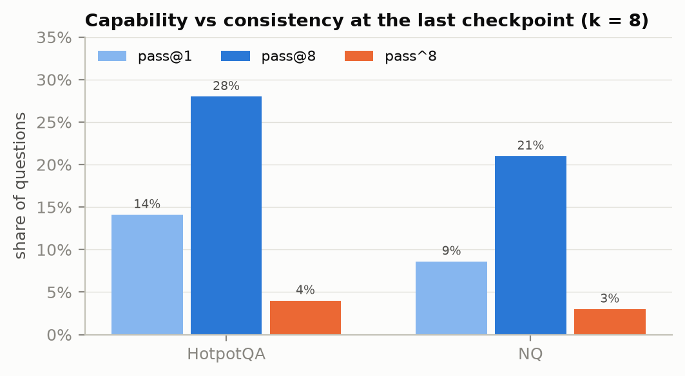

# nano-AgentRL

[](https://github.com/PRINCE2-AI/nano-agentrl/actions/workflows/ci.yml)
[](LICENSE)


**A from-scratch, readable re-implementation of [Search-R1](https://arxiv.org/abs/2503.09516):
GRPO that teaches a small LLM to reason, call a search engine, and answer. It is trained
end to end on free Kaggle GPUs — and then measured for reliability, not only for accuracy.**

The core RL loop (log-probs, GRPO, multi-turn rollouts, trainer, generation, rewards) is
~1,600 lines of PyTorch with 178 CPU tests. No verl, and no TRL in the trainer.



*Qwen2.5-0.5B-Instruct after 90 steps of search training. Eight samples per question: the
agent answers 21% (NQ) to 28% (HotpotQA) of questions correctly at least once, but only
3–4% of them every time. Sampling recovers about what one-shot RAG already "contains", so
the ceiling looks set by retrieval, not by the policy.*

## Results

All runs: Qwen2.5-0.5B-Instruct, free Kaggle notebook with 2× T4 (16 GB), greedy evaluation.
Full protocol, caveats and per-phase analysis are in [docs/experiment_log.md](docs/experiment_log.md).

**Single-turn GRPO on GSM8K**: 200 steps, 4.8 h, full 1,319-question test set.

| Model | GSM8K exact match |
|---|---|
| Qwen2.5-0.5B-Instruct | 32.4 ± 1.3 |
| + nano-AgentRL GRPO | **47.9 ± 1.4** |

**Multi-turn search agent (Search-R1 setup)**: 90 steps, 2.9 h, BM25 top-3 over 21M
Wikipedia passages, 500 NQ + 500 HotpotQA questions.

| Method | NQ EM | NQ gold-in-answer | HotpotQA EM | HotpotQA gold-in-answer |
|---|---|---|---|---|
| Direct answer (no retrieval) | 0.2 | 13.2 | 0.4 | 17.2 |
| RAG (question as query, one generation) | 0.0 | 22.0 | 0.8 | 27.4 |
| **nano-AgentRL search agent** | **13.0** | 16.0 | **19.6** | 25.4 |

*EM* is Search-R1's metric: SQuAD-normalized exact match of the text inside `<answer>`.
*Gold-in-answer* is lenient: is a gold answer anywhere in the model's own text, ignoring format?

**What the numbers say.** RL moved strict EM from ~0 to 13–20 and cut invalid outputs from
99% to under 1%. On the lenient metric, however, the agent does not beat single-step RAG:
the base model's long RAG answers already contain the gold more often. Most of the gain is
in *stating* answers cleanly, not yet in *finding* more of them. See
[Findings](#findings) for why and what to try next.

## Quickstart

```bash
pip install -e ".[dev]"                                                   # 1. install
pytest -q                                                                 # 2. 178 tests, CPU, ~30 s
python scripts/train.py --config configs/search_0.5b.yaml --dry_run       # 3. tiny end-to-end run
```

The dry run trains a random 2-layer GPT-2 against an in-memory corpus. It exercises the full
pipeline (multi-turn rollouts, loss masks, GRPO update, eval, checkpoint, resume) in seconds.

### Reproduce on a free Kaggle notebook (2× T4)

Prefer clicking to copy-pasting? [`notebooks/nano_agentrl_kaggle.ipynb`](notebooks/nano_agentrl_kaggle.ipynb)
is this whole recipe as a runnable notebook — on Kaggle, *File → Import Notebook*.

Notebook settings: *GPU T4 x2*, *Internet on*. One cell each:

```python
# 1. code
!git clone https://github.com/PRINCE2-AI/nano-agentrl
%cd nano-agentrl
!pip install -q -e ".[dev]"
# 2. GSM8K run (~5 h)
!python scripts/train.py --config configs/gsm8k_0.5b_t4.yaml
```

For the search agent, start the retriever first (Java 21 + Pyserini + the wiki-18 index and
corpus: ~5 min, all scripted), then train (~3 h):

```python
!bash scripts/kaggle/setup_retriever.sh
!python scripts/kaggle/start_retriever.py
!pip install -q bitsandbytes
!python scripts/train.py --config configs/search_0.5b_t4.yaml
```

The retriever script works on any Linux GPU box too (`DATA=/big/disk bash scripts/kaggle/setup_retriever.sh`).
Long runs on Kaggle: use *Save Version → Save & Run All* so they keep going with the browser closed.
Re-running with the same `run_dir` resumes from the latest checkpoint.
Evaluate a checkpoint or the base model:

```bash
python scripts/train.py --config configs/search_0.5b_t4.yaml --eval_only --ckpt <dir|base> \
    --set eval_num_examples=500
python scripts/evaluate.py --ckpt Qwen/Qwen2.5-0.5B-Instruct --mode rag --split nq_dev_500
```

Was it the retriever or the policy? `retrieval_recall.py` asks BM25 for the gold passage
twice: once with the raw question, once with the query the agent actually wrote.

```bash
python scripts/retrieval_recall.py --split nq_dev_500 --max_examples 100   # question only
python scripts/retrieval_recall.py --split nq_dev_500 \
    --records runs/search_0.5b_t4/reliability/90/nq_dev_500.jsonl          # question vs agent
```

## How it works

One training step:


Inside one rollout, the model and the environment take turns. Only the model's own tokens
are trained on:

```
prompt          <think>...</think><search>who wrote hamlet</search>  <information>Doc 1(Title: Hamlet)...</information>  <think>...</think><answer>Shakespeare</answer>
loss_mask: 0000 1111111111111111111111111111111111111111111111111111  00000000000000000000000000000000000000000000000000  11111111111111111111111111111111111111111111111
```

- **Rollout** (`rollout.py`) generates until `</search>` or `</answer>`. A query goes to the
  BM25 server, and the top-3 passages come back as `<information>`. An invalid action gets
  Search-R1's "My previous action is invalid…" message and a retry. Every token is tagged
  as policy (1) or environment (0) when it is appended.
- **Reward** (`rewards.py`) is 1 for an exact-match answer. An optional small format
  reward is computed on **policy tokens only**: the environment's own message contains
  `<answer>`, and scoring it would be reward hacking.
- **GRPO** (`grpo.py`): A_i = (r_i − mean) / std within each question's group, clipped
  ratio, k3 KL to a frozen reference, and a Dr. GRPO switch.
- **Log-probs** (`logprobs.py`): one forward pass, position ids taken from the attention
  mask (left padding stays exact), and `logit[y] − logsumexp` so a second
  vocabulary-sized tensor is never materialised.

The maths with tiny numeric examples is in [docs/grpo_math.md](docs/grpo_math.md).

## Findings

1. **GSM8K: the early gain is "stop rambling".** Truncated answers fell from a peak of ~60% to ~3%
   within the first 30 steps, and that is where most of the +15.5 points came from. With the format
   reward off, the `<answer>` tag drifted freely: it was never rewarded.
   ([figure](docs/figures/gsm8k_0.5b_t4/fig6_training_dynamics.png))
2. **Search: a format shortcut, then discovery.** A 0.1 format reward bootstrapped the
   protocol but created a stable local optimum (answer instantly, never search) for
   ~45 steps. Search appeared abruptly at step ~56, and EM followed.
   ([figure](docs/figures/search_0.5b_t4/fig4_searches.png))
3. **Better format is not better retrieval.** On a format-agnostic metric the agent trails
   one-shot RAG (NQ 16.0 vs 22.0). Untested causes: the agent's self-written BM25 queries
   may be weaker than the raw question, the lenient metric favours long answers, and
   training was short.
4. **Capable, but not reliable.** With 8 samples per question, the agent solves 21–28% of
   questions at least once (pass@8) but only 3–4% every time (pass^8). Between steps 75 and
   90, pass^k grew 2–4× while pass@8 stayed flat: training made it more consistent, not
   broader. ~70% of failures never retrieve the gold passage.
   ([reliability analysis](docs/reliability.md), [write-up](https://thereliableagent.substack.com/p/pass8-was-28-pass8-was-4-same-model))
5. **kl_coef 0.001 barely constrains the policy.** KL reached 0.3 on GSM8K and ~1.0 on
   search, and entropy collapsed within ~60 steps in both runs.

Bugs found along the way, each with a regression test: reward hacking through environment
text, wrong log-probs under left padding, an EOS that ended episodes early (Search-R1
retries instead), a GPU-resume crash, and an off-by-one between corpus lines and index ids.

## File map

| File | What it does |
|---|---|
| [nano_agentrl/logprobs.py](nano_agentrl/logprobs.py) | per-token log-probs with masks (off-by-one, padding) |
| [nano_agentrl/grpo.py](nano_agentrl/grpo.py) | group advantages, clipped GRPO / Dr. GRPO loss, k3 KL |
| [nano_agentrl/rollout.py](nano_agentrl/rollout.py) | batched multi-turn generate → search → continue, loss mask |
| [nano_agentrl/trainer.py](nano_agentrl/trainer.py) | training loop: reference model, micro-batching, checkpoints, eval |
| [nano_agentrl/generation.py](nano_agentrl/generation.py) | HF / vLLM sampling with stop strings, weight sync |
| [nano_agentrl/rewards.py](nano_agentrl/rewards.py) | EM, GSM8K numeric and format rewards |
| [nano_agentrl/prompts.py](nano_agentrl/prompts.py) | Search-R1 prompt and environment strings, copied verbatim |
| [nano_agentrl/retriever/](nano_agentrl/retriever/) | FastAPI BM25 server (Pyserini / rank_bm25) and client |
| [nano_agentrl/eval/](nano_agentrl/eval/) | EM, pass@k / pass^k, evaluation harness, failure taxonomy |
| [scripts/](scripts/) | train, evaluate, reliability sweep, retrieval recall@3, plots, ablations, trajectory viewer, Kaggle setup |
| [configs/](configs/) | GSM8K and search configs for one T4 notebook or one 80 GB GPU (0.5B / 1.5B / 3B) |

## Limitations and next steps

- Only 0.5B on T4s so far. The 1.5B / 3B configs target one 80 GB GPU and have not been run.
- BM25 only. Search-R1's headline numbers use E5 dense retrieval.
- Results are on 500-question subsets, not the full test sets, and come from one seed.
- The reliability sweep covers only the last two checkpoints and uses the rule judge.
- Next: compare retrieval recall@3 of agent queries against the raw question, anneal the
  format reward, keep every checkpoint for a full pass^k-over-training curve, and validate
  the failure taxonomy with the Claude judge plus hand labels.

## Following the work

The measurement problems that only show up once an agent meets real work end up in
**The Reliable Agent**, a newsletter on production systems engineering for AI agents.

- [Pass@8 was 28%. Pass^8 was 4%. Same model.](https://thereliableagent.substack.com/p/pass8-was-28-pass8-was-4-same-model) — the reliability analysis in this repo, written up: the four bugs that made the first number wrong, and why most failures are retrieval, not reasoning.
- [Why your agent eval passes locally and fails in production](https://thereliableagent.substack.com/p/why-your-agent-eval-passes-locally) — how a reliability score can be green and mean nothing, written against a scorer whose coverage metric only checked that a policy event existed.
- [Subscribe](https://thereliableagent.substack.com) — free posts on agent reliability; the paid tier adds runnable failure cases, eval harnesses, and teardowns.

## License

[MIT](LICENSE). The Search-R1 prompt template and environment strings in
`nano_agentrl/prompts.py` are copied verbatim from
[Search-R1](https://github.com/PeterGriffinJin/Search-R1) (Apache-2.0) and credited there.

## Citation

```bibtex
@misc{nanoagentrl2026,
  title  = {nano-AgentRL: a minimal re-implementation of Search-R1},
  author = {Prince},
  year   = {2026},
  url    = {https://github.com/PRINCE2-AI/nano-agentrl}
}
@article{jin2025searchr1,
  title   = {Search-R1: Training LLMs to Reason and Leverage Search Engines with Reinforcement Learning},
  author  = {Jin, Bowen and Zeng, Hansi and Yue, Zhenrui and Yoon, Jinsung and Arik, Sercan and
             Wang, Dong and Zamani, Hamed and Han, Jiawei},
  journal = {arXiv preprint arXiv:2503.09516},
  year    = {2025}
}
```
