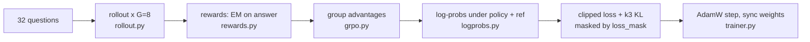

# nano-AgentRL

**Search-R1 in ~2,000 readable lines: train an LLM with GRPO to reason, search Wikipedia, and
answer. Then measure whether RL makes the agent *reliable*, not just accurate.**

A from-scratch PyTorch re-implementation of
[Search-R1](https://arxiv.org/abs/2503.09516) (Jin et al., 2025). It covers multi-turn GRPO
with retrieved-token loss masking, a BM25 retriever over wiki-18, and an evaluation harness
with pass^k ([τ-bench](https://arxiv.org/abs/2406.12045)) and an LLM-judged failure
taxonomy. No verl, no TRL in the trainer. It is built to be read end to end.

<!-- TODO (Prince): replace with the real figure once the 3B sweep exists -->


## Results

Exact match (%), greedy decoding, BM25 top-3, 500-question subsets (see
[docs/results.md](docs/results.md) for the protocol and the full table).

| Model | NQ | HotpotQA |
|---|---|---|
| Qwen2.5-3B-Instruct, direct answer | TODO | TODO |
| Qwen2.5-3B-Instruct, RAG (retrieve once) | TODO | TODO |
| Qwen2.5-3B-Instruct, search prompting (no RL) | TODO | TODO |
| Released Search-R1 checkpoint (3B-it, GRPO), our harness | TODO | TODO |
| **nano-AgentRL 3B-it GRPO (ours)** | TODO | TODO |
| Search-R1 paper (3B-it, GRPO, full test sets) | TODO: copy from paper | TODO |

## Quickstart

```bash
pip install -e ".[dev]"                                                   # 1. install
pytest -q                                                                 # 2. ~20 s on a CPU
python scripts/train.py --config configs/search_0.5b.yaml --dry_run       # 3. tiny end-to-end run
```

For a real run on a GPU box, start the retriever first (see
[Retrieval corpus](#retrieval-corpus-wiki-18-and-bm25-index)). Then:

```bash
python scripts/train.py --config configs/search_0.5b.yaml                 # or search_1.5b / search_3b
python scripts/evaluate.py --ckpt runs/search_0.5b/checkpoints/step_000300 --split nq_dev_500
python scripts/reliability_sweep.py --run_dir runs/search_0.5b --split nq_dev_500 --use_vllm
python scripts/plot.py --metrics runs/search_0.5b/metrics.jsonl \
    --reliability runs/search_0.5b/reliability.csv --out_dir docs/figures
```

## How it works

One training step:



Inside one rollout, the model and the environment take turns. Only the model's own tokens
are trained on:

```
prompt          <think>...</think><search>who wrote hamlet</search>  <information>Doc 1(Title: Hamlet)...</information>  <think>...</think><answer>Shakespeare</answer>
loss_mask: 0000 1111111111111111111111111111111111111111111111111111  00000000000000000000000000000000000000000000000000  11111111111111111111111111111111111111111111111
           │    └─ policy tokens: trained on                          └─ retrieved tokens: never trained on               └─ policy tokens
           └─ prompt
```

- **Rollout** (`rollout.py`) generates until `</search>` or `</answer>`. A search query goes
  to the retriever, and the top-3 docs come back as `<information>`. The loop runs for up
  to 4 turns, and every token is tagged with who produced it.
- **Reward** (`rewards.py`) is 1 if the SQuAD-normalized `<answer>` matches a gold answer,
  else 0. It is outcome-only.
- **GRPO** (`grpo.py`): A_i = (r_i − mean) / std within each question's group of 8, a
  clipped ratio (ε = 0.2), and k3 KL to the frozen reference. A switch selects Dr. GRPO.
- **Log-probs** (`logprobs.py`): one forward pass, with position ids computed from the
  attention mask so left padding is exact.

The maths with tiny numeric examples is in [docs/grpo_math.md](docs/grpo_math.md).

## File map

| File | What it does |
|---|---|
| [nano_agentrl/logprobs.py](nano_agentrl/logprobs.py) | per-token log-probs with masks (off-by-one, padding) |
| [nano_agentrl/grpo.py](nano_agentrl/grpo.py) | group advantages, clipped GRPO / Dr. GRPO loss, k3 KL |
| [nano_agentrl/rollout.py](nano_agentrl/rollout.py) | batched multi-turn generate → search → continue, loss mask |
| [nano_agentrl/trainer.py](nano_agentrl/trainer.py) | the training loop: reference model, micro-batching, checkpoints, logging |
| [nano_agentrl/generation.py](nano_agentrl/generation.py) | HF / vLLM sampling with stop strings, weight sync |
| [nano_agentrl/rewards.py](nano_agentrl/rewards.py) | EM, GSM8K numeric and format rewards |
| [nano_agentrl/prompts.py](nano_agentrl/prompts.py) | Search-R1 prompt and environment strings, copied verbatim |
| [nano_agentrl/retriever/](nano_agentrl/retriever/) | FastAPI BM25 server (Pyserini / rank_bm25) and client |
| [nano_agentrl/eval/](nano_agentrl/eval/) | EM, pass@k / pass^k, evaluation harness, failure taxonomy |
| [scripts/](scripts/) | train, evaluate, reliability sweep, plots, ablations, trajectory viewer, TRL sanity check, toy REINFORCE |
| [configs/](configs/) | `gsm8k_0.5b`, `search_0.5b`, `search_1.5b`, `search_3b` |

## Findings

TODO (Prince): fill in from the reliability sweep and the ablations. See
[docs/reliability.md](docs/reliability.md). Candidate questions:

1. Does pass^8 rise as fast as pass@1, or does the gap widen?
2. Which failure type shrinks most during training: format errors, bad queries, or ignored
   docs?
3. How much does retrieved-token masking matter (the `nomask` ablation)?

## Limitations

- One GPU means smaller batches than Search-R1 (64 rather than 512 prompts per step for 3B).
  Curves are noisier, and the results may sit below the paper's.
- Results are reported on 500-question subsets, not the full test sets.
- BM25 only. Search-R1's main results use E5 dense retrieval.
- The failure-taxonomy judge is an LLM. Its agreement with 50 hand labels is reported in
  [docs/reliability.md](docs/reliability.md), and the labels should be read with that in mind.
- `train/entropy` is the on-policy estimate E[−log π(token)], not the full-vocabulary entropy.

## Retrieval corpus (wiki-18) and BM25 index

Needed for the search task only, on the GPU machine. Not on a laptop: the corpus is
~14 GB unzipped and the index ~2.3 GB.

```bash
pip install -e ".[retriever]" huggingface_hub   # pyserini needs Java 21 (e.g. apt install openjdk-21-jdk)

# corpus: 21M Wikipedia passages, {"id", "contents": "\"Title\"\ntext"} per line
hf download PeterJinGo/wiki-18-corpus wiki-18.jsonl.gz --repo-type dataset --local-dir data/
gzip -d data/wiki-18.jsonl.gz

# prebuilt Lucene BM25 index
hf download PeterJinGo/wiki-18-bm25-index --repo-type dataset --local-dir indexes/wiki-18-bm25
# --index must point at the folder that contains the Lucene files (segments_*, *.cfs)
```

Start the server and check it:

```bash
python -m nano_agentrl.retriever.server --backend pyserini \
    --index indexes/wiki-18-bm25 --corpus data/wiki-18.jsonl --port 8000
curl -s localhost:8000/health
curl -s -X POST localhost:8000/search -H "Content-Type: application/json" \
     -d '{"queries": ["who wrote hamlet"], "topk": 3}'
python -m nano_agentrl.retriever.client --url http://127.0.0.1:8000 --num_queries 512   # q/s
```

Without Java you can test on a small slice with the pure-Python backend:
`python -m nano_agentrl.retriever.server --backend bm25 --corpus data/wiki-18.jsonl --corpus_limit 50000`.

## Citation

```bibtex
@misc{nanoagentrl2026,
  title  = {nano-AgentRL: a minimal re-implementation of Search-R1 with a reliability analysis},
  author = {Prince},
  year   = {2026},
  url    = {https://github.com/PRINCE2-AI/nano-agentrl}
}
@article{jin2025searchr1,
  title   = {Search-R1: Training LLMs to Reason and Leverage Search Engines with Reinforcement Learning},
  author  = {Jin, Bowen and Zeng, Hansi and Yue, Zhenrui and Yoon, Jinsung and Arik, Sercan and
             Wang, Dong and Zamani, Hamed and Han, Jiawei},
  journal = {arXiv preprint arXiv:2503.09516},
  year    = {2025}
}
```
